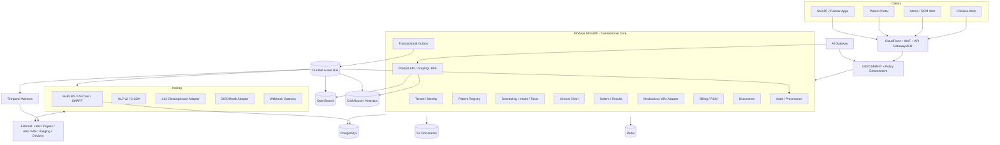
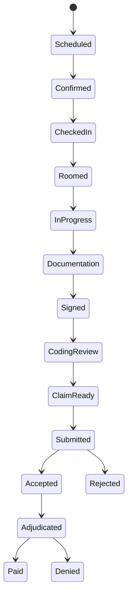
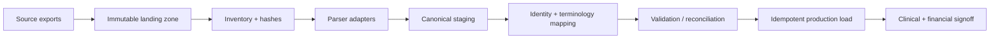

# EHR_BUILD_SPEC.md

> **Status:** Opinionated engineering specification for implementation
> **Audience:** Claude Code / senior engineering team / technical founder
> **Market assumption:** U.S. ambulatory/outpatient practices
> **Current regulatory baseline:** September 2026
> **Primary product thesis:** eClinicalWorks-level breadth + Athelas/Commure-style workflow compression + a materially better API/query platform.

---

# 0. Instructions to the coding agent

This document is authoritative for the first implementation unless a later Architecture Decision Record (ADR) explicitly supersedes it.

## Non-negotiable rules

1. **Do not implement this as dozens of microservices.** Start as a modular monolith with strict domain boundaries and asynchronous domain events. Split deployables only when reliability, scaling, security isolation, or team ownership proves the need.
2. **Do not use FHIR JSON as the primary transactional database.** PostgreSQL is the canonical operational store. FHIR is a standards boundary and mapping layer.
3. **Never allow AI, analytics, search, GraphQL, exports, or automation to bypass the authorization policy layer.**
4. **Every tenant-owned record carries `tenant_id`.** Every PHI-access path is tenant-scoped and authorization-tested.
5. **Never hard-delete signed clinical records.** Corrections are amendments/supersessions with provenance.
6. **Every material clinical or financial mutation must be attributable.** Store actor, time, source, request/correlation ID, before/after metadata where appropriate, and reason when required.
7. **Externally imported clinical facts are not silently promoted to authoritative chart data.** They enter an inbox/reconciliation state unless the workflow explicitly permits trusted ingestion.
8. **AI output is draft/advisory unless a human explicitly accepts it.** Store model/version, prompt/template version, source context references, output, reviewer, and disposition.
9. **Do not send PHI to any vendor until a signed BAA and approved subprocessor/security review exist.**
10. **No production data in developer laptops, consumer analytics, error-reporting payloads, or non-BAA tooling.**
11. **All write APIs must be idempotent where retries are realistic.**
12. **Use the transactional outbox pattern for domain events.** Never rely on `DB commit -> publish event` as two unrelated operations.
13. **Store effective time and recorded/system time separately for clinical facts.**
14. **All timestamps are UTC internally.** Preserve source timezone/offset where clinically or operationally meaningful.
15. **Prefer explicit state machines over loosely interpreted status strings.**
16. **Build exportability from day one.** A customer should be able to leave without a bespoke database extraction project.

---

# 1. Product definition

## 1.1 Product goal

Build a cloud-native ambulatory EHR + practice-management + revenue-cycle platform that can replace an incumbent EHR for a real outpatient practice while being unusually easy to integrate, query, automate, audit, and migrate.

The differentiator is not merely “AI EHR.” The differentiator is:

- every authorized datum is predictably addressable;
- every major object has a timeline, current state, pending work, and next action;
- standards APIs and product APIs are first-class;
- operational users can answer ordinary cohort/business questions without engineering;
- workflow automation is native but controlled;
- clinical provenance and auditability are built into the data model.

## 1.2 Primary users

- Front desk / scheduler
- Medical assistant / nurse
- Physician / APP
- Biller / RCM staff
- Practice administrator
- Patient / proxy
- Integration developer
- Internal support / implementation
- Security / compliance administrator

## 1.3 Initial specialty scope

**Initial target:** general ambulatory practices and specialty clinics that do not require highly specialized inpatient, anesthesia, chemotherapy, dialysis, or surgical-center intraoperative charting.

Support specialty configuration through templates, terminology/value sets, forms, order sets, and workflow rules rather than forking the core product.

## 1.4 Explicit non-goals for MVP

Do **not** build the following in the first pilot unless the anchor customer absolutely requires them:

- inpatient ADT/bed management;
- operating-room anesthesia record;
- full LIS;
- PACS/VNA pixel storage from scratch;
- pharmacy network from scratch;
- claims clearinghouse from scratch;
- payment processor from scratch;
- telephony/SMS carrier from scratch;
- direct Surescripts connectivity before a partner path is validated;
- custom video infrastructure;
- native iOS/Android apps before responsive web + PWA proves insufficient;
- autonomous diagnosis/treatment recommendation;
- autonomous coding submission without human review;
- full managed RCM service operation;
- TEFCA/QHIN participation as a day-one dependency;
- every U.S. state at launch.

---

# 2. Fixed technology decisions

These are the default choices for v1.

## 2.1 Application stack

| Layer | Decision | Notes |
|---|---|---|
| Monorepo | `pnpm` + Turborepo | Shared types, UI, API clients, test fixtures |
| Frontend | Next.js + React + TypeScript | Responsive clinician/admin/patient web surfaces |
| UI | shadcn/Radix primitives + internal design system | Accessibility and keyboard-first workflows |
| Backend | NestJS running on Fastify | Modular boundaries, DI, OpenAPI, background workers |
| Runtime | Current supported Node.js LTS | Pin exact runtime in repo/toolchain |
| Validation | Zod at external boundaries | Generate/validate request contracts |
| DB | PostgreSQL | Source of transactional truth |
| SQL layer | Kysely or equivalent typed SQL builder | Prefer explicit SQL control over heavy ORM magic |
| Cache | Redis/Valkey | Cache, distributed locks, rate counters; never sole durable state |
| Workflow engine | Temporal Cloud/self-hosted approved deployment | Long-lived retries, external integrations, RCM jobs, prior auth, migration |
| Event bus | AWS MSK/Kafka-compatible managed bus | Domain events and integration fan-out |
| Search | Amazon OpenSearch Service | Full-text/global search with tenant/sensitivity filters |
| Analytics | ClickHouse Cloud or AWS-hosted equivalent approved for PHI | Cohorts/ops/analytics; isolate from writer DB |
| Object storage | Amazon S3 | Documents, scanned files, exports, imports, attachments |
| FHIR engine | HAPI FHIR-based interoperability service | R4 API boundary; canonical data still lives in core DB |
| Auth | Auth0/Okta customer identity or AWS Cognito only after BAA/requirements review; workforce federation via OIDC/SAML | Keep app authorization in our policy layer |
| Policy engine | OpenFGA/OPA-style policy service + application checks | RBAC + contextual ABAC |
| IaC | Terraform | No console-only infrastructure |
| Cloud | AWS | Use only services covered by AWS BAA/eligible service scope for PHI |
| Containers | ECS/Fargate initially | Lower ops burden than Kubernetes for first pilot |
| Orchestration later | EKS only when justified | Not a launch requirement |
| Observability | OpenTelemetry + CloudWatch + approved SIEM/APM | PHI-safe logging rules required |
| Secrets | AWS Secrets Manager + KMS | No secrets in env files committed to repo |
| CI/CD | GitHub Actions with OIDC to AWS | No static cloud keys |

### Why ECS before Kubernetes

The original research correctly warns against overbuilding early. A regulated product needs reliable operations more than cluster sophistication. ECS/Fargate provides isolation, autoscaling, private networking, immutable containers, blue/green patterns, and lower operational overhead. Move to EKS only when workload or customer requirements justify it.

## 2.2 AWS account structure

Use AWS Organizations with separate accounts:

- `ehr-security`
- `ehr-log-archive`
- `ehr-shared-services`
- `ehr-dev`
- `ehr-test`
- `ehr-staging`
- `ehr-prod`

Production PHI must never be copied to dev/test. Use synthetic test patients.

Enable centrally:

- CloudTrail organization trails;
- GuardDuty;
- Security Hub;
- AWS Config;
- IAM Access Analyzer;
- KMS key policies;
- centralized log archive;
- SCPs blocking dangerous services/regions where appropriate.

---

# 3. High-level architecture



---

# 4. Repository structure

```text
/
  apps/
    clinician-web/
    admin-web/
    patient-portal/
    api/
    worker/
    interop-fhir/
    interop-hl7/
    webhook-gateway/
  packages/
    domain-common/
    authz/
    audit/
    db/
    api-contracts/
    event-contracts/
    fhir-mapping/
    terminology/
    ui/
    testing/
    observability/
    config/
  domains/
    tenant/
    workforce/
    patient/
    scheduling/
    intake/
    clinical/
    medication/
    orders/
    results/
    referrals/
    tasks/
    documents/
    messaging/
    billing/
    claims/
    payments/
    consent/
    portal/
    query/
    migration/
  infra/
    terraform/
    policies/
    dashboards/
  docs/
    adr/
    api/
    threat-model/
    clinical-safety/
    certification/
```

Each domain owns its tables, application services, state machines, events, and authorization rules. Cross-domain access occurs through application interfaces/read models, not arbitrary imports of private internals.

---

# 5. Canonical data model

## 5.1 Common columns

Every tenant-owned table should contain, as applicable:

```sql
tenant_id uuid not null,
id uuid primary key,
version bigint not null default 1,
created_at timestamptz not null,
created_by uuid,
updated_at timestamptz not null,
updated_by uuid,
recorded_at timestamptz not null,
source_type text not null,
source_system text,
source_id text,
status text not null,
metadata jsonb not null default '{}'::jsonb
```

Clinical facts additionally use:

```sql
effective_start timestamptz,
effective_end timestamptz,
entered_in_error boolean not null default false,
supersedes_id uuid,
provenance_id uuid not null
```

Never confuse clinical effective time with system insertion time.

## 5.2 Core aggregates

```text
Tenant
 └─ Organization
     └─ Location

User ─ WorkforceIdentity ─ Practitioner ─ PractitionerRole

Patient
 ├─ PatientIdentifier
 ├─ Address / Telecom
 ├─ Coverage
 ├─ RelatedPerson / Proxy
 ├─ Consent
 ├─ CommunicationPreference
 └─ PatientMergeHistory

Patient -> Appointment -> Encounter
Encounter -> Note / Diagnosis / Observation / Procedure / Charge
Patient -> Problem / Allergy / Medication / Immunization
ServiceRequest -> Specimen -> Observation -> DiagnosticReport
Patient -> Referral -> Task
Patient -> DocumentReference -> ObjectVersion
Encounter -> ChargeItem -> Claim -> ClaimVersion -> Remittance -> LedgerEntry
```

## 5.3 Patient identity

Do not use MRN as global primary key.

Use:

- internal UUID;
- per-organization MRN/identifier table;
- identifier type/system/value;
- uniqueness rules scoped to issuer;
- duplicate candidate scoring;
- explicit merge workflow;
- reversible merge metadata;
- immutable source identifiers for migration.

Potential match signals:

- legal name;
- DOB;
- sex/gender fields as appropriate;
- address;
- phone/email;
- payer member ID;
- government identifiers only where legally/operationally justified.

No automatic patient merge without configurable high-confidence rules and review.

## 5.4 Note/document lifecycle

State machine:

```text
DRAFT -> READY_FOR_REVIEW -> SIGNED -> AMENDED
                  \-> VOIDED/ENTERED_IN_ERROR
```

Once signed:

- preserve original;
- no destructive update;
- amendment references prior version;
- signer + signature timestamp retained;
- rendered final document can be hash-addressed for integrity evidence.

## 5.5 Medication model

Distinguish:

- medication concept;
- patient-reported medication;
- medication request/order;
- dispense history if received;
- administration;
- reconciliation event;
- discontinued/cancelled state;
- external source.

Use RxNorm normalization internally where possible. Do not rely only on free-text medication names.

## 5.6 Laboratory/result model

Preserve:

- placer/filler order IDs;
- accession number;
- specimen;
- performing lab;
- LOINC/code + source code;
- result value and raw text;
- UCUM unit when mappable;
- original unit;
- reference range;
- abnormal flag;
- critical flag;
- status (preliminary/final/corrected/amended/cancelled);
- source message/document;
- result timestamps;
- acknowledgement/review state;
- amendment chain.

Critical result alerts must be durable workflow tasks, not transient UI notifications.

---

# 6. Authorization model

## 6.1 Authentication

- Workforce: OIDC/SAML federation where available, MFA mandatory.
- Patients: OIDC identity with MFA/passkeys encouraged; recovery flow resistant to takeover.
- SMART apps: SMART App Launch OAuth flow.
- Backend integrations: OAuth client credentials/private key JWT or mTLS as appropriate.
- No permanent shared user accounts.

## 6.2 Authorization

Use layered policy:

1. tenant membership;
2. user status;
3. role permission;
4. resource relationship/context;
5. purpose/sensitivity restrictions;
6. consent/proxy rules;
7. state/special-law policy;
8. emergency/break-glass override where configured.

Representative permissions:

```text
patient.read.demographics
patient.read.clinical
patient.read.sensitive
patient.write.demographics
encounter.create
encounter.sign
medication.prescribe
controlled_substance.prescribe
claim.edit
claim.submit
report.query.population
api.manage_clients
audit.read
breakglass.invoke
```

## 6.3 Break glass

Require:

- explicit user action;
- reason code + free-text justification;
- elevated audit event;
- time-limited access;
- compliance review queue;
- optional alert to privacy/security officer.

---

# 7. Audit and provenance

## 7.1 Audit requirements

Capture at minimum:

- authentication events;
- PHI reads where practical and legally/operationally relevant;
- searches producing patient lists;
- exports/downloads;
- create/update/sign/amend/delete-equivalent actions;
- permission/admin changes;
- API access;
- break-glass;
- integration access;
- AI prompts/context/result acceptance where PHI is involved;
- support impersonation/delegated access.

Event envelope:

```json
{
  "event_id": "uuid",
  "tenant_id": "uuid",
  "occurred_at": "2026-09-25T18:30:00Z",
  "actor": {"type":"user","id":"uuid"},
  "action": "observation.read",
  "resource": {"type":"Observation","id":"uuid","patient_id":"uuid"},
  "purpose": "treatment",
  "request_id": "uuid",
  "ip": "tokenized-or-restricted-field",
  "user_agent": "...",
  "outcome": "success"
}
```

Forward logs to an append-only/tamper-evident store with restricted deletion. Keep operational application logs PHI-minimized.

## 7.2 Provenance

All imported and AI-derived clinical data needs provenance records containing:

- original source;
- source identifier;
- import/interface message ID;
- mapping/transformation version;
- author/performer;
- recorder;
- review status;
- acceptance/rejection decision.

---

# 8. API strategy

The system exposes **three query lanes**.

## 8.1 Lane A: standards API

Use FHIR R4 as the interoperability baseline with US Core profiles required by target certification scope.

Endpoints:

```text
/.well-known/smart-configuration
/fhir/r4/metadata
/fhir/r4/Patient/{id}
/fhir/r4/Observation?patient={id}&category=laboratory
/fhir/r4/Encounter?patient={id}
/fhir/r4/Patient/{id}/$everything
/fhir/r4/Group/{id}/$export
```

FHIR service requirements:

- CapabilityStatement generated from deployed capability;
- SMART scopes;
- profile validation;
- version-aware US Core support;
- deterministic mapping from canonical IDs;
- `_lastUpdated`, paging, search parameters as required;
- Bulk Data async export;
- provenance links where appropriate;
- standardized OperationOutcome errors.

## 8.2 Lane B: product REST API

Use OpenAPI-first conventions.

```text
/api/v1/patients
/api/v1/patients/{id}/timeline
/api/v1/appointments
/api/v1/encounters
/api/v1/orders
/api/v1/results
/api/v1/tasks
/api/v1/referrals
/api/v1/claims
/api/v1/claims/{id}/timeline
/api/v1/cohorts
/api/v1/webhooks
/api/v1/audit-events
```

Conventions:

- cursor pagination;
- `Idempotency-Key` on retryable writes;
- `If-Match` / ETags for optimistic concurrency;
- RFC-style problem responses;
- `X-Request-Id` / correlation ID;
- explicit API versions;
- documented deprecation windows;
- sparse fieldsets only if authorization is applied before serialization;
- filtering through allowlisted fields/operators.

Example response:

```json
{
  "data": [{"id":"...","mrn":"...","name":{"given":"Jane","family":"Doe"}}],
  "page": {"next_cursor":"...","has_more":true},
  "meta": {"request_id":"...","as_of":"2026-09-25T18:30:00Z"}
}
```

## 8.3 Lane C: query/cohort API

Do not expose unrestricted SQL to normal customers.

Create a versioned cohort DSL:

```json
{
  "version": 1,
  "entity": "patient",
  "where": {
    "all": [
      {"field":"age","op":"between","value":[45,75]},
      {"concept":"condition","system":"ICD10CM","op":"active","value":"E11"},
      {"measure":"latest_hba1c","op":">","value":9},
      {"measure":"days_since_completed_encounter","op":">","value":180}
    ]
  }
}
```

The query compiler must:

1. resolve semantic fields to approved models;
2. apply tenant filter;
3. apply authorization/sensitivity filter;
4. estimate query cost;
5. execute against analytics/read models;
6. persist query ID, user, interpretation, parameters, and result metadata;
7. return freshness timestamp.

## 8.4 Natural-language query

NL query is only a front end to the cohort DSL.

Flow:

```text
User question
 -> LLM produces candidate DSL
 -> deterministic validator
 -> show interpreted query to user
 -> authorization policy
 -> execute query
 -> return aggregate/result set according to permission
```

The LLM never receives a raw database credential.

## 8.5 GraphQL

GraphQL is allowed for internal screen composition/BFF reads and selected partners.

Requirements:

- field-level authorization;
- depth/cost limits;
- persisted queries for privileged surfaces;
- no arbitrary cross-tenant node resolution;
- full audit correlation;
- DataLoader/batched reads;
- not a substitute for FHIR.

---

# 9. Search

Global search must support:

- patient name/MRN/contact;
- encounter/note text where policy allows;
- document metadata;
- labs/results;
- task/referral;
- claim identifiers;
- provider/location.

Every indexed document includes:

```text
tenant_id
patient_id (if applicable)
resource_type
resource_id
sensitivity_tags
allowed_context_tags
version
indexed_at
```

Search filters authorization **inside the search query**. Do not retrieve unauthorized candidates and filter afterward.

---

# 10. Event architecture

Event envelope:

```json
{
  "event_id":"uuid",
  "event_type":"encounter.signed.v1",
  "tenant_id":"uuid",
  "aggregate_type":"encounter",
  "aggregate_id":"uuid",
  "aggregate_version":18,
  "occurred_at":"...",
  "actor_id":"uuid",
  "correlation_id":"uuid",
  "causation_id":"uuid",
  "data":{}
}
```

Rules:

- events are immutable;
- version event schemas;
- consumers must be idempotent;
- use DLQs;
- replay from known offset;
- do not put unnecessary PHI in event bodies;
- events do not replace canonical tables.

Important events:

```text
patient.created.v1
patient.updated.v1
patient.merged.v1
appointment.booked.v1
appointment.checked_in.v1
encounter.started.v1
encounter.signed.v1
order.placed.v1
result.received.v1
result.corrected.v1
result.critical.v1
medication.prescribed.v1
claim.created.v1
claim.submitted.v1
claim.acknowledged.v1
claim.denied.v1
remittance.received.v1
payment.posted.v1
consent.changed.v1
document.imported.v1
audit.breakglass.v1
```

---

# 11. Core workflows

## 11.1 Appointment-to-claim golden path



System must expose one timeline linking appointment, encounter, note, orders/results, charges, claim, remittance, patient balance, and tasks.

## 11.2 Lab result workflow

```text
Order placed
 -> adapter transmission
 -> external ACK
 -> specimen/result messages
 -> parse + validate + source provenance
 -> map terminology
 -> attach to order/patient
 -> critical/abnormal rules
 -> clinician inbox
 -> review/acknowledge
 -> patient release policy
 -> amended result preserves prior version
```

## 11.3 External record reconciliation

Incoming C-CDA/FHIR/HL7 clinical items become `external_candidate` records.

For medications/problems/allergies:

- show source;
- compare to current chart;
- accept / reject / mark duplicate / replace;
- record reviewer;
- preserve original import.

---

# 12. Interoperability layer

Support:

- FHIR R4;
- US Core compatibility layer;
- SMART App Launch;
- Bulk FHIR;
- HL7 v2 (ADT, SIU where needed, ORM/ORU, MDM as needed);
- C-CDA import/export/reconciliation;
- X12 via clearinghouse adapter;
- DICOMweb references/integration;
- signed webhooks;
- Direct messaging only where customer/certification workflows require it.

## 12.1 HL7 ingestion pattern

```text
Listener -> raw immutable message store -> parse -> validate -> route -> transform -> canonical staging -> reconciliation/idempotency -> commit -> ACK/NACK -> event
```

Always preserve raw message and message control ID.

## 12.2 Terminology service

Provide central terminology package handling:

- SNOMED CT;
- LOINC;
- RxNorm;
- ICD-10-CM;
- HCPCS;
- CPT where licensed;
- UCUM;
- local/source code mappings.

Never scatter terminology mappings through feature code.

---

# 13. Revenue cycle

## 13.1 Build vs buy

**Build:**

- charge capture;
- coding review workflow;
- claim object and versions;
- claim scrubber rules unique to product/customer;
- claim timeline;
- denial/task workflow;
- remittance posting engine;
- patient ledger;
- reporting;
- external clearinghouse abstraction.

**Buy/integrate:**

- payer network/clearinghouse connectivity;
- eligibility routing;
- X12 transport;
- payer enrollment tooling where offered;
- EFT/payment rails;
- card processing.

A practical API-first clearinghouse candidate is Stedi because its current healthcare APIs support JSON/X12 for 270/271 eligibility, 837 claims, 277CA acknowledgments, 276/277 status, and 835 ERAs. Keep the adapter generic so it can be replaced.

## 13.2 Claim model

Never mutate a submitted claim in place.

```text
Claim
 ├─ ClaimVersion 1 (draft)
 ├─ ClaimVersion 2 (submitted)
 ├─ ClaimVersion 3 (corrected/resubmission)
 ├─ ClearinghouseTransactions
 ├─ PayerResponses
 ├─ Remittances
 ├─ Denials
 └─ Tasks
```

---

# 14. ePrescribing / EPCS

Do not build pharmacy-network connectivity from scratch for v1.

Create an adapter interface:

```ts
interface PrescribingGateway {
  searchMedication(...): Promise<MedicationConcept[]>;
  searchPharmacy(...): Promise<Pharmacy[]>;
  getFormulary(...): Promise<FormularyInfo>;
  sendPrescription(...): Promise<PrescriptionReceipt>;
  cancelPrescription(...): Promise<void>;
  refillResponse(...): Promise<void>;
}
```

Use a Surescripts-connected/certified partner such as DoseSpot, DrFirst, or equivalent after diligence. EPCS requires separate identity-proofing/authentication and DEA-compliant workflows; treat it as a gated epic, not merely another REST endpoint.

---

# 15. AI architecture

## 15.1 AI gateway

All AI requests pass through one internal gateway responsible for:

- approved model/vendor list;
- BAA/PHI eligibility enforcement;
- prompt templates/versioning;
- minimum-necessary context assembly;
- redaction when appropriate;
- rate/cost controls;
- model/version capture;
- evaluation telemetry;
- safety policies;
- deterministic post-validation;
- audit/provenance.

## 15.2 Allowed initial AI features

- ambient note draft;
- encounter summary draft;
- chart Q&A grounded only in retrieved chart evidence;
- patient-message drafting;
- coding suggestions;
- denial explanation summarization;
- workflow/task summarization;
- NL-to-cohort-DSL.

## 15.3 Prohibited autonomous behavior in v1

- final diagnosis;
- treatment plan without clinician review;
- autonomous prescription;
- autonomous controlled-substance action;
- autonomous claim submission based solely on LLM output;
- silent chart mutation;
- unsourced addition of clinical facts.

## 15.4 AI provenance object

```json
{
  "model_provider":"approved-provider",
  "model_id":"...",
  "model_version":"...",
  "prompt_template_version":"note-draft-v4",
  "source_refs":["Encounter/...","Observation/..."],
  "generated_at":"...",
  "output_hash":"...",
  "reviewer_id":"...",
  "decision":"accepted_with_edits"
}
```

---

# 16. Documents and files

Use S3 with:

- tenant prefix/metadata;
- SSE-KMS;
- blocked public access;
- malware scanning pipeline;
- MIME sniffing;
- size limits;
- immutable source objects for imports;
- versioning where appropriate;
- pre-signed URLs with short expiry;
- authorization check before URL issuance;
- retention/legal-hold metadata.

Never expose raw S3 bucket paths to clients.

---

# 17. Patient portal

MVP portal:

- profile/contact updates with review rules;
- appointments;
- intake/forms;
- secure messages;
- visit summaries/documents;
- released results;
- medications/problem/allergy visibility as policy permits;
- bills/payments;
- proxy access;
- record export request;
- API/app authorization management.

Proxy relationships must be explicit, effective-dated, and scoped. Minor/adolescent access is a state-law-dependent policy problem, not a simple `parent=true` flag.

---

# 18. Security engineering requirements

## 18.1 Baseline

- TLS 1.2+; prefer TLS 1.3.
- AES-256-class managed encryption at rest via KMS-backed services.
- MFA for workforce.
- short-lived tokens.
- secure cookies + CSRF protection where applicable.
- CSP, HSTS, secure headers.
- no PHI in URLs when avoidable.
- no PHI in analytics/telemetry by default.
- dependency/SBOM generation.
- SAST, SCA, secret scanning, IaC scanning.
- container image scanning.
- WAF/rate limits.
- admin actions require stronger authorization.
- least-privilege workload roles.
- production database private subnets only.
- database PITR/backups and restore tests.
- ransomware-resilient backup strategy.

## 18.2 Tenant isolation tests

For every repository/query path, tests must prove:

```text
Tenant A authenticated user cannot read Tenant B object by guessed UUID.
Tenant A cannot search Tenant B.
Tenant A cannot export Tenant B.
Tenant A cannot subscribe to Tenant B webhook/event.
Tenant A cannot access object storage belonging to Tenant B.
```

These are release-blocking tests.

## 18.3 Support access

Internal support access:

- disabled by default;
- JIT elevation;
- customer/tenant context;
- explicit reason/ticket;
- MFA;
- session recording or equivalent privileged audit where feasible;
- time-bound;
- fully audited.

---

# 19. Observability and clinical operations telemetry

Track infrastructure plus workflow health:

- oldest unreviewed critical result;
- unsigned notes by age;
- prescriptions awaiting ACK;
- lab interface queue age;
- failed HL7 messages;
- claim submission failures;
- claims stuck by lifecycle state;
- 277CA rejection rate;
- ERA import failures;
- webhook failures/DLQ;
- search lag;
- analytics freshness;
- patient merge queue;
- break-glass events;
- anomalous chart-access volume;
- backup age;
- last verified restore;
- AI failure/unsupported-fact rates.

---

# 20. Testing strategy

## 20.1 Test pyramid

- unit tests for domain rules/state machines;
- property tests for clinical numeric/unit transforms;
- DB integration tests using real PostgreSQL;
- API contract tests;
- authorization negative tests;
- UI E2E tests;
- FHIR profile/conformance tests;
- HL7 fixture tests;
- C-CDA validation tests;
- X12 partner/test-mode integration;
- performance/load tests;
- migration reconciliation tests;
- backup/restore drills;
- chaos/dependency-failure tests;
- security penetration tests;
- clinical golden-patient scenarios.

## 20.2 Golden patient cases

Maintain synthetic cases for:

- duplicate patients;
- allergy conflict;
- medication reconciliation;
- lab correction/amendment;
- critical result;
- wrong unit;
- external-record reconciliation;
- consent restriction;
- minor/proxy scenario;
- claim rejection/resubmission;
- denial + corrected claim;
- AI unsupported statement;
- chart amendment after signing.

---

# 21. Migration framework

Pipeline:



Every migration produces a manifest with:

- source files and hashes;
- source record counts;
- target counts;
- rejected rows;
- unmapped codes;
- duplicate/merge decisions;
- earliest/latest dates;
- documents and hashes;
- active med/allergy/problem reconciliation;
- recent lab reconciliation;
- appointments;
- open orders/referrals;
- claims/A/R/patient balance totals;
- signoff.

Do not declare migration complete because ETL executed successfully.

---

# 22. Environments and data

| Environment | PHI allowed? | Purpose |
|---|---|---|
| local | No | unit/dev with synthetic fixtures |
| dev | No real PHI | integration development |
| test | No real PHI | automated QA |
| staging | Prefer synthetic/de-identified; production-like controls | release validation |
| prod | Yes | customer workloads |

If production-like PHI must ever be used outside production, require explicit privacy/security approval and equivalent controls; default answer is **no**.

---

# 23. CI/CD gates

Pull request gates:

- lint/typecheck;
- unit/integration tests;
- authorization tests;
- OpenAPI/FHIR contract diff;
- migration safety check;
- secret scan;
- dependency vulnerability scan;
- IaC scan;
- SBOM generation;
- container scan.

Production release gates:

- peer approval;
- signed artifact/image digest;
- database migration plan + rollback/forward-fix strategy;
- automated smoke tests;
- feature flag for risky clinical changes;
- release notes;
- audit trail of deployment actor;
- post-deploy health checks.

High-risk clinical changes require clinical informatics review.

---

# 24. Performance objectives

Initial engineering targets, not customer SLAs:

| Operation | p95 target |
|---|---:|
| Patient by ID | <150 ms |
| Indexed list | <300 ms |
| FHIR resource read | <250 ms |
| FHIR first-page indexed search | <500 ms |
| Global chart search | <750 ms |
| Initial chart shell | <2 s |
| Standard internal write | <500 ms excluding external dependency |
| Pre-indexed cohort over ~1M patients | <5 s |
| Domain event downstream visibility | <5 s |
| Analytics default freshness | <5 min |

---

# 25. UX rules

1. Patient header persists across chart screens.
2. Every major object has `Summary | Timeline | Tasks | Documents | Audit` pattern where applicable.
3. Keyboard navigation and shortcuts are first-class.
4. Minimize modal chains.
5. Avoid “save” buttons for safe drafts; use explicit signing/finalization for legally/clinically meaningful commits.
6. Show source/provenance on external data.
7. Show unsaved/draft/unsigned/signed states clearly.
8. Never hide failed integrations behind generic “processing” indefinitely.
9. Claim workflow is a single chronological lifecycle.
10. Patient chart supports filtered longitudinal timeline.
11. Search is global but permission-aware.
12. Build role-specific home queues: front desk, clinician inbox, results, refills, referrals, billing, admin.

---

# 26. Build order

## Phase 0 — Discovery and compliance foundation

Deliver before serious clinical coding:

- anchor-practice workflow mapping;
- target-state launch jurisdiction(s);
- legal/compliance advisor engaged;
- AWS BAA/account structure;
- vendor/subprocessor register;
- threat model;
- HIPAA risk-analysis framework;
- certification strategy decision;
- terminology licensing plan;
- data-retention policy requirements;
- clinical safety owner.

## Phase 1 — Platform foundation

Build:

- monorepo;
- IaC;
- auth;
- tenant/org/location;
- workforce roles;
- policy engine;
- PostgreSQL conventions;
- audit pipeline;
- outbox/events;
- document storage;
- observability;
- synthetic fixtures;
- CI/CD.

**Exit gate:** cross-tenant isolation tests pass; audit events exist for all foundation APIs.

## Phase 2 — Patient + scheduling + intake

Build:

- patient registry;
- identifiers/merge workflow;
- coverage basics;
- scheduling;
- check-in;
- forms/intake;
- tasks;
- patient timeline shell.

## Phase 3 — Clinical chart

Build:

- encounters;
- notes/templates;
- problems;
- allergies;
- meds/reconciliation;
- vitals/observations;
- procedures;
- document ingestion;
- signing/amendment.

## Phase 4 — Orders/results + interoperability

Build in parallel:

- orders;
- lab adapter framework;
- result inbox;
- critical-result workflow;
- HL7 v2;
- C-CDA reconciliation;
- FHIR R4;
- SMART auth;
- initial US Core profiles.

## Phase 5 — eRx integration

- vendor integration;
- pharmacy search;
- new Rx/refill/cancel;
- medication history/formulary if provided;
- EPCS only after compliance/vendor prerequisites are satisfied.

## Phase 6 — RCM

- charges;
- coding queue;
- claim model/versioning;
- eligibility;
- claim validation/submission;
- 277CA/status;
- 835 ERA;
- remittance posting;
- patient ledger;
- denial/task workflow.

## Phase 7 — Query platform

- OpenSearch;
- analytics CDC;
- cohort semantic model;
- visual cohort builder;
- governed SQL for internal analysts;
- NL-to-DSL assistant;
- exports.

## Phase 8 — Patient portal + payments + messaging

- portal;
- proxies;
- secure messaging;
- results release;
- records download;
- bills/payments;
- SMS/email notification adapter.

## Phase 9 — AI features

Only after audit/auth/provenance are mature:

- ambient scribe;
- chart Q&A;
- patient-message draft;
- coding suggestions;
- denial summaries.

## Phase 10 — Pilot readiness

- migration dry runs;
- end-to-end golden workflows;
- downtime procedures;
- support operations;
- security assessment;
- penetration test;
- restore test;
- clinical safety review;
- launch-state legal review;
- vendor enrollments;
- pilot training.

---

# 27. Claude Code implementation method

For each epic, Claude Code must produce:

1. ADR if architectural choice changes anything in this spec.
2. Domain model/state machine.
3. Database migration.
4. Authorization policy matrix.
5. API/OpenAPI contract.
6. Audit event list.
7. Domain events.
8. Tests including negative authorization tests.
9. Observability metrics/alerts.
10. Migration/rollback notes.
11. Security/privacy checklist.
12. UI acceptance criteria.
13. Documentation update.

### Required PR template

```markdown
## Change
## Clinical/operational purpose
## Data touched
## PHI classification
## Authorization rules
## Audit events
## External dependencies
## Failure modes
## Tests
## Migration/rollback
## Observability
## Clinical safety impact
## Compliance/certification impact
```

---

# 28. Definition of done

A feature is not done until:

- happy path works;
- failure/retry states work;
- authorization is enforced and negatively tested;
- tenant isolation is tested;
- audit/provenance is emitted;
- idempotency/concurrency behavior is defined;
- UI state is accessible and understandable;
- telemetry exists;
- synthetic E2E test exists for material workflow;
- API docs update automatically;
- data migration/backfill is defined if needed;
- security/privacy review completed for new PHI flow;
- clinical review completed for patient-care-impacting behavior;
- feature flag/rollback path exists where appropriate.

---

# 29. Vendor abstraction boundaries

Do not let vendor schemas leak into core domains.

Adapters:

```text
ClearinghouseGateway
PrescribingGateway
LabGateway
ImagingGateway
FaxGateway
MessagingGateway
PaymentGateway
IdentityProofingGateway
TelehealthGateway
AIModelGateway
HIEGateway
```

Every adapter maps vendor payload -> internal integration DTO -> canonical domain.

---

# 30. First pilot recommendation

The first production pilot should be intentionally narrower than the final EHR:

**Include:**

- real patient registry;
- scheduling/intake;
- encounter documentation;
- vitals/problems/allergies/medication reconciliation;
- labs/results for the anchor practice's actual lab partners;
- eRx through partner;
- referrals/tasks;
- basic billing/eligibility/claims/remits for the practice's payer mix;
- patient portal basics;
- audit/security;
- FHIR/SMART baseline;
- import/export/migration;
- one genuinely excellent cohort/query surface.

**Delay:**

- RPM unless anchor customer truly needs it;
- advanced telehealth;
- extensive specialty packs;
- autonomous AI;
- enterprise multi-region active/active;
- on-prem deployment;
- direct pharmacy-network certification;
- custom clearinghouse network;
- broad nationwide exchange contracts.

---

# 31. Architecture success criteria

The system succeeds technically when:

1. A clinician can move from appointment -> chart -> orders -> sign without bouncing through disconnected applications.
2. A biller sees the entire claim lifecycle in one timeline.
3. An authorized analyst can build an ordinary cohort without an engineer.
4. A partner developer can integrate using published OpenAPI/FHIR docs and a sandbox without vendor hand-holding.
5. Every displayed clinical datum can answer “where did this come from?”
6. Every sensitive access can answer “who accessed it, when, and why?”
7. A customer can export its data without a custom engineering engagement.
8. An external system outage creates visible durable work, not lost data.
9. AI can never silently turn an unsupported statement into signed clinical truth.
10. Tenant A cannot access Tenant B through any application, API, search, analytics, export, object-storage, or AI path.

---

# 32. Primary current references

- ASTP/ONC HTI-1 Final Rule: https://healthit.gov/regulations/hti-rules/hti-1-final-rule/
- ASTP/ONC §170.315(g)(10): https://isp.healthit.gov/svap-reference-standard/ss-170315g10-standardized-api-patient-and-population-services
- ASTP/ONC SVAP: https://healthit.gov/certification-health-it/certification-criteria/standards-version-advancement-process-svap/
- HHS HIPAA Security Rule: https://www.hhs.gov/hipaa/for-professionals/security/laws-regulations/index.html
- HHS HIPAA Security Rule NPRM: https://www.hhs.gov/hipaa/for-professionals/security/hipaa-security-rule-nprm/index.html
- AWS HIPAA compliance: https://aws.amazon.com/compliance/hipaa-compliance/
- AWS HIPAA eligible services: https://aws.amazon.com/compliance/hipaa-eligible-services-reference/
- Stedi healthcare APIs: https://www.stedi.com/docs/healthcare
- HAPI FHIR: https://hapifhir.io/

